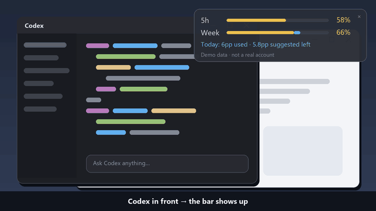

<div align="center">

# Codex Quota Peek

**Glance at the corner of your screen to see how much Codex quota is left, and how much you can safely use today.**

A quiet Windows quota overlay that appears only while you work in Codex · Unofficial

[](https://github.com/lidagou527-lili/codex-quota-peek/releases)
[](#-get-started-in-3-steps)
[](https://github.com/lidagou527-lili/codex-quota-peek/actions/workflows/ci.yml)
[](LICENSE)

[中文](README.md) · [Download](https://github.com/lidagou527-lili/codex-quota-peek/releases) · [Privacy](PRIVACY.md) · [Test coverage](docs/TESTING.md) · [Changelog](CHANGELOG.md)



<sub>Demo animation uses synthetic data, not a real account</sub>

</div>

---

## Why

| Before | With Codex Quota Peek |
| --- | --- |
| Dig into settings to check quota, then forget it | Switch to Codex and the bar appears in the corner |
| "66% of the week left" — but how much is today's share? | A **daily suggested budget** and **what's left of it** |
| Burn through quota early in the week, run dry by Friday | Spread evenly across remaining days, with a 10% reserve |
| Worried a third-party tool touches your credentials | Read-only queries through Codex's own login — no passwords, cookies or API keys |

## ✨ Features

- 🟨 **Real remaining quota**: yellow bars for the `5h` short window and `Week`, reported by Codex itself.
- 🟦 **Daily budget**: blue shows how much weekly quota you've used today and how much is suggested to remain.
- 👀 **Stays out of the way**: visible only while Codex is in front; hides when you switch away and keeps updating in the background.
- 🖱️ **Easy to adjust**: drag it anywhere and it remembers the spot; the tray menu switches between Codex-only and always-visible.
- 🔒 **Local-first**: data stays on your machine — no analytics, telemetry or upload service.
- 📦 **Portable**: the ZIP bundles Node.js; extract, double-click, done.
- 🌏 **Bilingual**: English and Chinese, following your Windows language by default.

## 🚀 Get started in 3 steps

> **Requires** Windows 10/11 x64 and Codex installed and signed in with a ChatGPT subscription.

1. Download `codex-quota-peek-0.1.0-alpha.1-win-x64.zip` from [Releases](https://github.com/lidagou527-lili/codex-quota-peek/releases).
2. **Extract** it to any folder (don't run it from inside the ZIP).
3. Double-click `Launch.cmd`, then switch to Codex.

Exit with the small `×` or the tray menu. It doesn't start with Windows; double-click `Launch.cmd` again next time.

## 📊 Reading the bar

```text
5h    ██████████░░░░░░  58%    ← short-window quota actually remaining
Week  ███████████▒░░░░  66%    ← weekly quota actually remaining (▒ blue = used today)
Today: 6pp used · 5.8pp suggested left
       └ 6 percentage points of the full week used today, 5.8 more suggested
```

- **pp = percentage points of the full weekly allowance**. It is not a percentage of the short-window pool, a token count, or a number of messages.
- The footer shows the last successful query time and the short-window reset countdown.
- When a query fails, the last values stay on screen instead of dropping to 0.

### How the daily suggestion works

The day's suggested total is fixed at the first valid sample of the day:

```text
today's budget = remaining weekly quota ÷ max(days until weekly reset, 1) × (1 − reserve)
```

> **Example**: 70% of the week left, 5 days to reset, 10% reserve → **12.6pp** suggested for today; after using 5pp, **7.6pp** left.

This is a planning estimate, **not an official daily limit**. Every calendar day gets an equal share, weekends included.

## ⚙️ Settings

Tray menu → Open settings. Changes are picked up automatically. All data lives in `%LOCALAPPDATA%\CodexQuotaPeek`.

| Key | Default | Meaning |
| --- | --- | --- |
| `showMode` | `codex` | `codex` = only while Codex is in front; `always` = always visible |
| `reservePercent` | `10` | Reserve kept back, 0–90 |
| `foregroundSeconds` / `backgroundSeconds` | `15` / `60` | Polling interval in seconds, minimum 15; failures back off up to 5 minutes |
| `language` | `auto` | `auto` / `zh` / `en` |
| `timeZone` | `local` | Time zone that defines "today", or an IANA name such as `Asia/Shanghai` |
| `codexPath` | empty | Full path to `codex.exe` if auto-detection fails (escape backslashes as `\\`) |

See [settings.example.json](settings.example.json) for a full example.

## 🔒 Privacy

- Uses Codex's built-in `app-server` for **read-only** account and rate-limit queries, reusing the login Codex already manages.
- Never asks for or stores passwords, cookies, API keys or emails. Accounts are separated by a salted local fingerprint.
- No telemetry, ads or upload service. See [PRIVACY.md](PRIVACY.md).

## ❓ FAQ

<details>
<summary><b>The bar doesn't appear</b></summary>

Make sure the Codex window is in front, or switch to "always visible" in the tray menu. Connection errors are recorded in `%LOCALAPPDATA%\CodexQuotaPeek\status.json`.
</details>

<details>
<summary><b>It says Codex can't be found</b></summary>

It looks for the engine installed with the Codex desktop app first, then `codex.exe` on PATH. If neither is found, set `codexPath` in settings. A CLI on PATH must already be signed in.
</details>

<details>
<summary><b>"Used today" looks too low</b></summary>

Counting starts at the first sample of the day; usage before the app was running can't be reconstructed.
</details>

<details>
<summary><b>Week shows <code>--</code></b></summary>

Your plan didn't report a weekly allowance. The short window still displays, but the daily budget is unavailable.
</details>

<details>
<summary><b>What if quota resets during the day?</b></summary>

Earlier usage is kept and the remaining suggestion is reallocated from the new quota. The blue segment only covers the current quota cycle.
</details>

<details>
<summary><b>How do I uninstall?</b></summary>

Exit and delete the extracted folder. To clear usage history, also delete `%LOCALAPPDATA%\CodexQuotaPeek`. This does not sign you out of Codex.
</details>

## ⚠️ Alpha notes

Tested on one Windows 11 x64 computer so far. Windows 10, other plans, multiple monitors and high-DPI scaling still need testing. The release is **not code-signed**; follow your administrator's script policies.

- Depends on the Codex App Server protocol; protocol or install-location changes may need an update.
- Local ledgers keep the last 14 days; a corrupt ledger restarts from a new baseline.
- Not yet supported: auto-update, start with Windows, macOS / Linux, API credit balances.

See [docs/TESTING.md](docs/TESTING.md) for the full test checklist. Testers welcome 🙌

## 🛠️ Develop

Requires Node.js 22+.

```powershell
npm test                    # 22 unit tests
npm run check               # syntax check
powershell -NoProfile -ExecutionPolicy Bypass -File scripts/check-windows.ps1
# One real query against your local Codex (writes separate test data)
powershell -NoProfile -ExecutionPolicy Bypass -STA -File Start.ps1 -Check -DataDirectory "$env:TEMP\quota-peek-check"
```

- Render a synthetic screenshot: `Start.ps1 -PreviewPath docs/preview.png`
- Build the portable ZIP: `scripts/build.ps1` downloads Node 24 LTS from nodejs.org, verifies its official SHA256, and writes to `dist/`.

## 🤝 Feedback

[Open an issue](https://github.com/lidagou527-lili/codex-quota-peek/issues) with your Windows version, Codex version, install method, reproduction steps and sanitized error messages.

> ⚠️ Never attach `auth.json`, tokens, emails or full usage ledgers.

## Credits & license

Quota is queried through the [Codex App Server](https://developers.openai.com/codex/app-server). Thanks to other open-source tools exploring quota visualization; this project doesn't claim to be the first.

By **[lidagou527-lili](https://github.com/lidagou527-lili)** · Code under [MIT](LICENSE) · Bundled Node.js license in [third-party notices](THIRD-PARTY-NOTICES.md)

<sub>Codex and OpenAI are names of their respective owners. This project is not affiliated with or endorsed by OpenAI.</sub>
