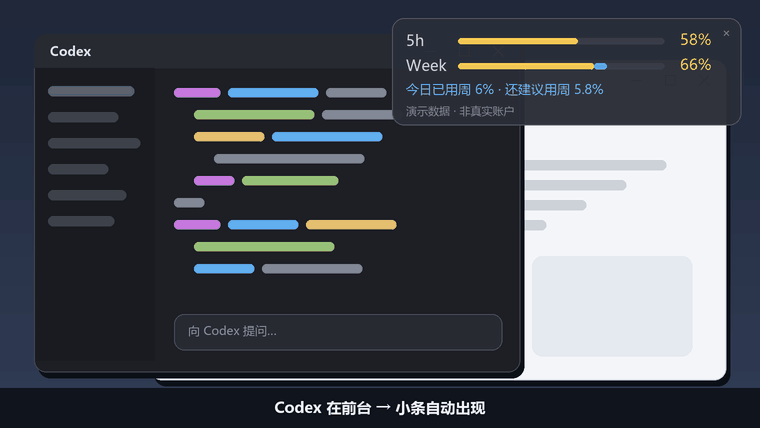

<div align="center">

# Codex Quota Peek

**写代码时瞄一眼，就知道 Codex 额度还剩多少、今天还能放心用多少。**

只在你使用 Codex 时出现的 Windows 额度小条 · 非官方工具

[](https://github.com/lidagou527-lili/codex-quota-peek/releases)
[](#-3-步上手)
[](https://github.com/lidagou527-lili/codex-quota-peek/actions/workflows/ci.yml)
[](LICENSE)

[English](README.en.md) · [下载](https://github.com/lidagou527-lili/codex-quota-peek/releases) · [隐私说明](PRIVACY.md) · [测试范围](docs/TESTING.md) · [版本记录](CHANGELOG.md)



<sub>演示动画使用合成数据，不代表任何真实账户</sub>

</div>

---

## 为什么需要它

| 以前 | 用了之后 |
| --- | --- |
| 想看额度得翻到设置页，看完又忘了 | 切到 Codex，小条自动出现在屏幕角落 |
| 只知道“周额度剩 66%”，不知道今天该用多少 | 自动算出**今天的建议用量**和**还剩多少** |
| 周中前几天用太猛，周末没额度可用 | 按剩余天数均摊，默认留 10% 余量 |
| 担心第三方工具碰到账号密码 | 只读查询，复用 Codex 自己的登录，不要密码、Cookie 或 API Key |

## ✨ 特性

- 🟨 **真实余额**：黄色进度条显示 `5h` 短时额度和 `Week` 周额度，数据来自 Codex 本身。
- 🟦 **今日预算**：蓝色显示今天已用了多少周额度，以及还建议用多少。
- 👀 **不打扰**：只在 Codex 处于前台时显示，切走自动隐藏，后台照常更新。
- 🖱️ **随手可调**：可拖动并记住位置；托盘菜单切换“仅 Codex 显示 / 始终显示”。
- 🔒 **本地优先**：数据只存在本机，没有统计、遥测或上传服务。
- 📦 **开箱即用**：便携 ZIP 自带 Node.js，解压双击即可运行，无需安装。
- 🌏 **中英双语**：默认跟随 Windows 语言。

## 🚀 3 步上手

> **前提**：Windows 10/11 x64，已安装 Codex 并用 ChatGPT 订阅登录。

1. 从 [Releases](https://github.com/lidagou527-lili/codex-quota-peek/releases) 下载 `codex-quota-peek-0.1.0-alpha.1-win-x64.zip`。
2. **解压**到任意文件夹（不要在 ZIP 里直接运行）。
3. 双击 `Launch.cmd`，然后切到 Codex。

右上角 `×` 或托盘菜单可以退出。程序不会开机自启，下次用时再双击 `Launch.cmd` 即可。

## 📊 怎么看这个小条

```text
5h    ██████████░░░░░░  58%    ← 短时额度实际剩余
Week  ███████████▒░░░░  66%    ← 周额度实际剩余（▒ 蓝段 = 今天用掉的部分）
Today: 6pp used · 5.8pp suggested left
       └ 今天已用整周额度的 6 个百分点，还建议再用 5.8 个
```

- **pp = 整周额度的百分点**，不是短时额度的百分比，也不是 token 数或对话次数。
- 底部显示最后一次成功查询的时间和短时额度重置倒计时。
- 查询失败时保留上次的数据，不会把额度显示成 0。

### 今日建议怎么算

每天第一次取得有效数据时固定当天的建议总量：

```text
今日建议 = 周剩余额度 ÷ max(距周重置天数, 1) × (1 − 预留比例)
```

> **举例**：周额度剩 70%，距重置 5 天，预留 10% → 今天建议用 **12.6** 个百分点；已经用了 5 个 → **还能用 7.6** 个。

这是均摊规划，**不是官方每日上限**。每天按同样的比例分配，不区分工作日和周末。

## ⚙️ 设置

托盘菜单 → 打开设置。修改后会自动生效。所有数据都在 `%LOCALAPPDATA%\CodexQuotaPeek`。

| 设置项 | 默认值 | 说明 |
| --- | --- | --- |
| `showMode` | `codex` | `codex` = 只在 Codex 前台时显示；`always` = 一直显示 |
| `reservePercent` | `10` | 预留比例，可设 0–90 |
| `foregroundSeconds` / `backgroundSeconds` | `15` / `60` | 查询间隔（秒），最少 15；失败后最多退避到 5 分钟 |
| `language` | `auto` | `auto` / `zh` / `en` |
| `timeZone` | `local` | 计算“今天”用的时区，也可以填 `Asia/Shanghai` 这类时区名 |
| `codexPath` | 空 | 自动找不到 Codex 时，填 `codex.exe` 的完整路径（反斜杠写成 `\\`） |

完整示例见 [settings.example.json](settings.example.json)。

## 🔒 隐私

- 通过 Codex 自带的 `app-server` **只读**查询账户额度，沿用 Codex 已有的登录。
- 不要求、也不保存密码、Cookie、API Key 或邮箱。账户只在本地生成加盐指纹，用来区分不同账户。
- 没有遥测、广告或上传服务。详见 [PRIVACY.md](PRIVACY.md)。

## ❓ 常见问题

<details>
<summary><b>小条没有出现？</b></summary>

先确认 Codex 窗口在前台；或者在托盘菜单里切到“始终显示”。连接错误会记录在 `%LOCALAPPDATA%\CodexQuotaPeek\status.json`。
</details>

<details>
<summary><b>提示找不到 Codex？</b></summary>

程序会先找 Codex 桌面端自带的引擎，再找 PATH 中的 `codex.exe`。都找不到时，请在设置里填写 `codexPath`。
</details>

<details>
<summary><b>“今日已用”为什么比实际少？</b></summary>

统计从当天第一次采样开始，无法追溯启动之前的消耗。
</details>

<details>
<summary><b>Week 显示 <code>--</code>？</b></summary>

你的套餐没有返回周额度。这时短时额度仍然可以显示，但今日建议不可用。
</details>

<details>
<summary><b>同一天里额度被重置了怎么办？</b></summary>

此前的消耗会保留，并按新的额度重新分配剩余建议。蓝段只画当前额度周期内的消耗。
</details>

<details>
<summary><b>怎么卸载？</b></summary>

退出后删除解压出来的文件夹即可。如果想清除用量记录，再删除 `%LOCALAPPDATA%\CodexQuotaPeek`。这不会让你退出 Codex 登录。
</details>

## ⚠️ Alpha 版说明

目前只在一台 Windows 11 x64 电脑上验证过。Windows 10、其他套餐、多显示器和高 DPI 缩放还需要更多人测试。发行包**尚未代码签名**；如果公司策略禁止运行 PowerShell 脚本，请遵守管理员的设置。

- 依赖 Codex App Server 协议，协议或安装位置变化后可能需要更新本工具。
- 本地账本只保留最近 14 天；账本损坏时会从新的基线重新开始统计。
- 暂不支持：自动更新、开机自启、macOS / Linux、API 计费余额。

完整的测试清单见 [docs/TESTING.md](docs/TESTING.md)。欢迎帮忙测试 🙌

## 🛠️ 开发

需要 Node.js 22+。

```powershell
npm test                    # 22 个单元测试
npm run check               # 语法检查
powershell -NoProfile -ExecutionPolicy Bypass -File scripts/check-windows.ps1
# 真实连接本机 Codex 查询一次（会生成独立的测试数据）
powershell -NoProfile -ExecutionPolicy Bypass -STA -File Start.ps1 -Check -DataDirectory "$env:TEMP\quota-peek-check"
```

- 生成合成数据截图：`Start.ps1 -PreviewPath docs/preview.png`
- 构建便携包：`scripts/build.ps1`。它会从 nodejs.org 下载 Node 24 LTS 并校验官方 SHA256，产物在 `dist/`。

## 🤝 反馈

欢迎[提交 Issue](https://github.com/lidagou527-lili/codex-quota-peek/issues)。请写明 Windows 版本、Codex 版本、安装方式、复现步骤，以及脱敏后的错误信息。

> ⚠️ 请不要上传 `auth.json`、token、邮箱或完整的个人账本。

## 致谢与许可

通过 [Codex App Server](https://developers.openai.com/codex/app-server) 查询账户额度。感谢同类开源工具在额度可视化方向上的探索；本项目不宣称首创。

作者 **[lidagou527-lili](https://github.com/lidagou527-lili)** · 代码采用 [MIT](LICENSE) 许可 · 便携包中 Node.js 的许可见[第三方说明](THIRD-PARTY-NOTICES.md)

<sub>Codex、OpenAI 是其各自权利人的名称。本项目与 OpenAI 无关，也未获其官方背书。</sub>
