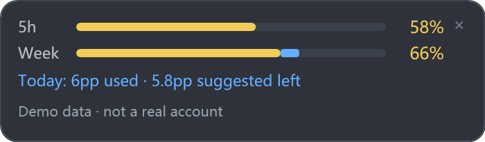

# Codex Quota Peek

**只在你使用 Codex 时出现的 Windows 额度小条。非官方工具。**

[English](README.en.md) · [隐私说明](PRIVACY.md) · [测试范围](docs/TESTING.md) · [版本记录](CHANGELOG.md)



黄色表示短时和每周的**实际剩余额度**，蓝色表示**今天监测后的周额度消耗**。切到其他软件自动隐藏，切回 Codex 自动显示；隐藏期间仍会更新。截图使用合成数据，不代表任何真实账户。

## 下载与启动

在本仓库 **Releases** 下载 `codex-quota-peek-0.1.0-alpha.1-win-x64.zip`。解压到你自己的文件夹，双击 `Launch.cmd`。**不要在ZIP内直接运行。** 便携包包含 Node.js，无需另外安装 Node。

前提：Windows 10/11 x64、Windows PowerShell 5.1，以及已经安装并通过 ChatGPT 订阅登录的 Codex。当前仅在 Windows 11 x64 的一台电脑上验证，Windows 10 与其他套餐仍需社区测试。不是浏览器扩展，也不是官方商店插件。不支持 macOS、Linux 或直接API计费余额。

开始运行后，系统托盘出现入口，可切换“仅Codex显示/始终显示”、打开设置、查看连接状态及退出。小条可拖动，会保存位置，右上角 `×` 会退出。默认不会开机自启，也不会替你安装、登录或修改 Codex。下次使用时再次运行 `Launch.cmd`。

下载的源码不包含Node运行环境。开发者可安装 Node.js 22+ 后运行 `Launch.cmd`；如果企业策略禁止PowerShell脚本，请遵循管理员策略，不要关闭安全防护。Alpha发行包尚未代码签名。

## 怎么看

- `5h`：实际短时额度。以接口返回的时长为准，其他时长显示对应标签。
- `Week`：实际周剩余额度；套餐未返回时显示 `--`。
- 蓝字 `Today: 6pp used · 5.8pp suggested left`：今天监测后消耗了整周额度的6个百分点，还建议消耗5.8个百分点。**pp不是短时额度的百分比，也不是token数或聊天次数。**
- 底部显示最后成功查询时间及短时重置倒计时。查询失败保留余额、蓝条和统计，不会把旧记录变成0。

界面语言默认跟随Windows；可将设置中的 `language` 改为 `zh` 或 `en`。中文蓝字显示“今日已用周 X% · 还建议用周 X%”，其中 `%` 同样指整周额度百分点。

## 每日建议如何计算

每天第一次有效采样时固定建议总量：

`周剩余额度 ÷ max(距周重置的剩余天数, 1) × (1 − 预留比例)`

默认预留10%。例如周剩70%、距重置5天，当日建议消耗12.6个周额度百分点；监测后消耗5点，则还建议用7.6点。**这是均摊规划，不是官方每日限额，也不保证一定可工作多久。** 默认按每天均衡使用分配，不区分工作日和周末。

“今日”使用本地日历日，从当天首次采样开始统计，无法追溯启动前的消耗。每个账户独立存储。同日额度重置会保留此前消耗，并从新额度重新分配剩余建议；蓝段只绘制当前额度周期内的今日消耗。鼠标悬停可查看统计起点。

## 设置与数据

设置、用量与状态位于 `%LOCALAPPDATA%\CodexQuotaPeek`，不写入程序安装目录。托盘菜单可打开设置，修改后自动读取。有效设置示例见 [settings.example.json](settings.example.json)。

- `codexPath`：找不到Codex时填写实际的 `codex.exe` 完整路径，JSON反斜杠需写成 `\\`。自动检测首先找Codex桌面端安装的引擎，其次找PATH中的 `codex.exe`。
- `foregroundSeconds` / `backgroundSeconds`：前台/后台查询间隔，默认15/60秒，最少15秒。失败会指数退避，最多5分钟；不是逐token实时更新。
- `reservePercent`：0–90，默认10；每日预算建立后固定，改预留比例主要影响下一天或下一额度周期。
- `timeZone`：`local` 或有效IANA时区，如 `Asia/Shanghai`，用于每日统计；重置倒计时、界面时间使用Windows本地时间。
- `showMode`：`codex` 或 `always`；仅Codex模式通过前台进程的产品元数据识别官方桌面窗口。

查看 `status.json` 可获取连接错误。程序不会要求你把密码、Cookie、API Key或原始登录文件粘贴进设置。额度通过Codex的 `app-server` 只读查询，沿用Codex已有登录。

## 已知限制

- Alpha，不同安装方式、套餐、显示缩放和多屏尚未全部验证；没有官方兼容承诺。
- 依赖Codex App Server协议和本机已有登录；协议或安装位置变化可能需要更新。没有周额度或重置时间时，日预算不可用，短时额度仍可显示。
- 账户标识不可用时停止合并统计；不同账户的本地指纹与日记录分离。同日中断监测、重置时遗漏的消耗无法完全补算。
- 旧数据会保留，底部明确显示重试；网络恢复后按退避间隔重连。登录失效时请自行到Codex重新登录。
- 历史账本损坏时从新基线恢复，不能保证修复损坏前的完整统计。日预算仅保留最近14天账目。
- 没有自动升级、开机启动、Claude或豆包采集。本版本暂不展示工作时长预测。

退出并删除解压文件夹即可卸载；若想清除个人用量和设置，再自行删除 `%LOCALAPPDATA%\CodexQuotaPeek`。删除本工具数据不会退出Codex账户。

## 开发与验证

```powershell
npm test
npm run check
powershell -NoProfile -ExecutionPolicy Bypass -File scripts/check-windows.ps1
powershell -NoProfile -ExecutionPolicy Bypass -STA -File Start.ps1 -Check -DataDirectory "$env:TEMP\quota-peek-check"
```

最后一条会实际连接本机Codex并生成独立测试数据；不要让两个进程使用同一数据目录。生成合成数据截图：`Start.ps1 -PreviewPath docs/preview.png`。构建便携包：`scripts/build.ps1`，将从nodejs.org下载Node 24 LTS并校验官方SHA256。构建产物位于 `dist/`。

欢迎提交Issue，说明Windows版本、Codex版本、安装方式、复现步骤和脱敏后的连接错误。请不要上传auth.json、token、邮箱或完整个人账本。

## 致谢与许可

使用 [Codex App Server](https://developers.openai.com/codex/app-server) 查询账户额度。感谢同类开源工具对额度可视化方向的探索；本项目不宣称首创。

作者：**lidagou527-lili**。本项目代码采用 [MIT](LICENSE) 许可。Codex、OpenAI为其各自权利人的名称；本项目未获OpenAI官方背书。便携包中的Node.js及其依赖许可见 [第三方说明](THIRD-PARTY-NOTICES.md)。
